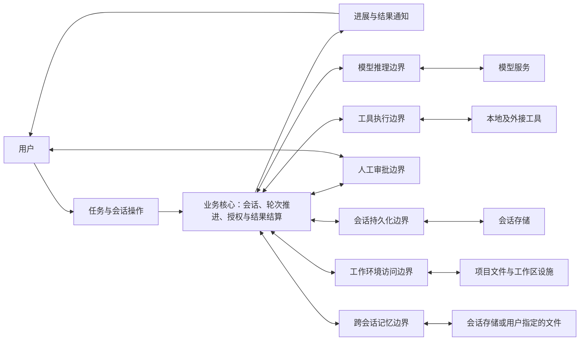

# 软件架构

Super Agent 的核心业务是在用户指定的工作环境与授权范围内，持续推进用户委托的任务，并交付回答或工作成果。本文件定义这项业务的组成、边界及约束，不规定代码组织。

项目目的见[愿景](vision.md)，功能范围见[产品定义](product.md)，业务概念见[核心概念](concepts.md)，质量要求见[质量目标与约束](constraints.md)。具体行为由各领域规范细化，实现映射见[模块与文件职责](../spec/packages.md)。

## 系统范围

用户可以提交任务、观察进展、审批操作，在执行过程中调整方向，或排队提交后续输入。Agent 利用模型理解上下文、提出后续行动，通过工具读取和修改工作环境，并将执行结果带回后续推理，直到本轮响应结束。

系统保存会话历史，并提供恢复会话、压缩上下文、重置和撤销已跟踪变更的能力。它负责组织任务执行及其记录；模型推理、具体工具操作和数据存储由外部能力提供。

同一套会话可以经由两个前端使用：终端界面和本机浏览器界面。两者共用同一应用接口，不各自实现业务，并暴露同一组用户操作，只有呈现方式不同；默认入口与各平台的可用范围由[产品定义](product.md#前端与平台)规定，Windows 不提供终端界面。无界面批处理和远程多用户服务不在当前范围内。

## 前端与 Agent 应用服务的边界

本项目有两个前端：终端界面和本机 Web 界面。两者负责呈现信息、接收用户意图和维护交互状态，界面形态分别由[界面设计](ui.md)、[使用体验设计](ux.md)和[应用接口规范](../spec/application-interface.md)规定。

它们连接的是同一个 Agent 应用接口，而不是同一份界面代码。接口后面包括会话与执行用例、领域规则，再通过能力边界调用模型、工具、存储和工作环境等基础设施。业务决策与外部能力保持分离。

```text
        用户                        用户 + 浏览器
          ↕ 按键、终端绘制            ↕ HTTP + SSE
      终端适配器                     Web 适配器
          └──────────────┬──────────────┘
                         ↕ 应用命令、视图、通知、审批与取消
                   前端契约（端口与展示值）
                         ↕
              Agent 应用服务与领域规则
                         ↕ 外部能力契约
             模型、工具、存储与工作环境
```

应用接口是逻辑边界：终端在进程内直连，Web 用本机 HTTP 与事件流承载。两种承载方式都不改变命令、视图、通知与审批的语义；具体数据、流生命周期与错误约定由[应用接口规范](../spec/application-interface.md)定义。

前端不直接调用模型或存储，不判断内部状态转移。应用服务不规定界面的颜色和布局，通过展示数据与通知支持前端交互。

## 本项目的六边形架构

六边形的内部是“接受委托并持续推进任务”的业务，外部是用户、模型服务和实际工作环境。端口围绕这些业务交互定义，适配器连接终端、Web、模型服务、工具和存储。

### 业务核心

| 业务职责 | 负责的决策 | 业务边界 |
|---|---|---|
| 会话与上下文管理 | 本次工作延续哪些历史、指令和附件，恢复或压缩后从什么上下文继续 | 会话内容不由终端展示或模型服务商保存的状态决定 |
| 轮次与步骤推进 | 接纳输入后如何开始、继续和结束本轮响应，如何处理工具批次及后续输入 | Turn、Step 和输入归属遵守[核心概念](concepts.md)，不由一次请求或工具调用的结束直接决定 |
| 操作授权 | 某项操作可以直接执行、需要用户审批，还是必须拒绝 | 模型提出的工具调用是行动建议，不能直接视为授权 |
| 执行结果结算 | 如何处理工具结果、拒绝、失败与取消，以及如何继续或结束响应 | 每个已分发调用必须得到结果，旧执行活动不能改变新的活动 |
| 工作环境与历史恢复 | 本次工作允许访问什么范围，恢复会话或撤销操作时如何保持环境与历史相符 | 文件访问范围与配置可信范围分离；历史恢复不等于继续执行中断的外部操作 |

这些职责共同构成 Agent 的业务核心，不预设它们分别对应独立服务或数据实体。六边形内部同时包含领域规则和应用用例，两者按以下判据区分。

### 职责的严格判据

| 类别 | 判定依据 | 可以承担 | 不得承担 |
|---|---|---|---|
| 领域逻辑 | 改变它会改变任务、授权、会话事实或结果有效性的业务含义 | 状态转移、不变量、权限决策、输入归属、结果结算规则 | 外部 I/O、SDK 或传输协议、界面呈现 |
| 应用逻辑 | 为完成一个用户意图，决定领域规则与外部能力的调用顺序和失败收尾 | 用例编排、事务与补偿、审批关联、取消传播、生命周期钩子和资源使用 | 创建具体适配器、解析磁盘或第三方协议、直接读写文件或启动进程 |
| 端口契约 | 描述应用与外部参与者之间的一项交互，且由应用需要决定形状 | 操作、输入输出值、错误、取消与生命周期约定 | 具体 SDK 对象、连接、文件句柄或适配器实现类型 |
| 适配器 | 把一种外部实现或承载方式转换为端口契约 | 协议转换、实际 I/O、后端校验与隔离、技术资源管理 | 决定轮次推进、授权结果或业务补偿顺序 |
| 组合根 | 决定当前进程采用哪些具体实现并连接它们 | 读取启动配置、创建和注入依赖、启动与关闭 | 承载每次业务操作的长期控制流程 |

应用逻辑可以调用具体的内部领域对象；依赖反转发生在应用与外部实现的边界，不要求内部每次函数调用都经过接口。适配器仍须执行属于后端的路径校验、协议校验和隔离约束，不能因为它们包含判断就归入领域核心。

### 端口与适配器

一个接口只有同时满足以下条件，才称为本项目的六边形端口：

1. 跨越 Agent 应用与用户交互承载或外部能力实现的边界。
2. 契约由应用需要定义，输入输出使用应用拥有的值类型，不暴露具体实现。
3. 更换外侧实现时，调用侧业务用例不需要随技术实现改写。

按交互由谁发起，端口分为两类：

- **入站端口**（驱动端口）：外部先发起，应用实现；表达用户或前端可以对应用做什么。
- **出站端口**（被驱动端口）：应用先发起，适配器实现；表达应用需要外部提供什么。

入站适配器调用入站端口，出站适配器实现出站端口；二者只依赖内侧拥有的契约与值。方向取决于交互由谁发起，与数据流向、进程边界或传输方式无关。入站调用的通知、流式回复和审批请求属于该交互的反馈协议，不能因为数据向外发送就自动增加出站端口。

| 方向 | 端口族 | 外侧实现 |
|---|---|---|
| 入站 | 前端应用操作（任务、配置、会话、权限、Agent、记忆、服务商、MCP、附件、工作区查询、扩展） | 终端、Web |
| 出站 | 模型推理与按配置取得模型 | 模型服务商适配器及模型解析适配器 |
| 出站 | 工具执行与扩展工作流调用 | 内建工具、MCP、LSP 及工具包装 |
| 出站 | 会话持久化、工作区、记忆、附件读取与导出 | 会话存储、工作区和记忆后端 |
| 出站 | 配置持久化、指令加载、MCP 管理、委派环境构造 | 本地设置、项目指令、MCP 管理和子会话设施 |
| 出站 | 遥测记录 | 日志后端 |

人工审批请求与回答沿前端应用交互往返，不单列独立出站端口。内部测试替身接口、调度器接口、资源关闭接口和适配器内部 SPI 都不能仅凭采用接口形式就称为端口。完整契约与实现映射由[模块职责](../spec/packages.md#端口与适配器映射)维护。

### 混合职责的拆分规则

- 先识别该代码决定的业务事实，再识别它实际使用的技术资源；不得根据目录名、类名或是否使用异步来判定归属。
- 同一方法同时组织业务流程并执行外部操作时，把外部操作抽到适配器，通过应用拥有的出站契约调用；顺序、补偿和错误结算保留在应用侧。
- 外部配置、SDK 值和协议消息在边界转换；业务状态不得由适配器直接改写。展示值的转换与用例编排分开维护。
- 组合根只组装依赖；运行期间的业务控制器归应用层，运行期间的具体设施归适配器。兼容入口只允许转发或注入，不复制业务实现。
- 一个适配器可以实现多个端口，一个端口可以有多个适配器；不为每个具体工具、数据库文件或内部辅助对象增加端口。
- 拆分保持现有用户行为、取消与审批语义、持久化格式及失败收尾；契约确实变化时先修改负责的 Spec。

### 用户侧边界：驱动业务的入站端口

| 业务交互 | 用户表达的意图 | 系统承担的责任 |
|---|---|---|
| 任务提交 | 开始一次工作，提供问题或附件 | 接纳输入并启动本轮响应 |
| 执行干预 | 追加引导、排队后续输入或取消执行 | 按输入归属和生命周期约定处理，不由界面自行重启或改写执行流程 |
| 会话操作 | 恢复、压缩、重置、分支或撤销 | 在历史与工作环境约束下完成相应操作 |

这些交互由两个前端接入；两端暴露同一组操作，只有呈现方式不同。进展、回复、工具活动、审批请求和错误通过业务通知返回用户；前端负责呈现，不判断任务应当进入哪个业务阶段。

### 能力侧边界：业务依赖的出站端口

| 业务需要的能力 | 向外请求什么 | 接收什么 | 外部承接者 |
|---|---|---|---|
| 模型推理 | 当前上下文和可用工具说明 | 回复、推理内容或工具调用建议 | 模型服务 |
| 工具执行 | 经过权限处理的操作及工作范围约束 | 工具执行结果或失败 | 本地工具或外接工具服务 |
| 人工审批 | 需要用户决定的具体操作 | 允许一次、始终允许或拒绝 | 经前端交互的用户 |
| 会话持久化 | 需要保存的会话事实，或读取历史的请求 | 持久化结果或保存的记录 | 会话存储 |
| 工作环境访问 | 文件访问、检查点和环境恢复请求 | 文件内容、环境描述或操作结果 | 项目文件系统与工作区设施 |
| 跨会话记忆 | 需要保存或读取的记忆行 | 已保存的记忆行 | 会话存储或用户指定的文件 |

审批由业务流程发起，用户决定通过前端返回；这与用户主动提交新任务是不同交互。工具执行和工作环境访问描述不同的业务需要，不要求每一行都对应一个独立实现。

### 业务交互图



箭头表示业务请求与结果流，不表示代码依赖。具体终端协议、模型协议、命令执行方式和磁盘格式都由边界外的适配能力处理。

## 核心业务闭环

以用户委托“修复一个失败的测试”为例：

1. 接纳任务及相关上下文，开始本轮响应。
2. 向模型请求下一步建议，例如读取代码、运行测试。
3. 判断这些操作的权限；需要时向用户请求审批。
4. 通过工具执行获准操作，将结果纳入当前上下文。
5. 继续推理和执行，期间按约定接纳用户追加的引导。
6. 返回最终回答，或按取消、失败路径结束本轮响应；保存应保留的历史。

模型服务只提供推理结果，工具只提供操作结果，终端只承接交互。输入如何影响当前工作、何时需要审批、何时继续或结束，以及保留什么记录，均由业务核心负责。

## 依赖方向

入站端口由应用实现、前端调用；出站端口由业务核心定义，模型服务、工具、存储、工作环境和记忆的适配能力实现。业务核心不依赖某个具体模型服务商、终端表现形式、工具通信方式或磁盘布局。

更换这些外部实现时，只要业务契约不变，就不应改变会话、轮次、授权和结果结算的规则。外部数据在交互边界转换为业务能够理解的事实，不能让外部实现决定内部业务状态。

## 执行约束

- 整个任务推进流程只有一个调度权威，模型调用、工具执行和审批等待由同一流程驱动。
- 领域规则先形成决策，后续工作只能在该决策通过校验并生效后执行。
- 状态变化与相应的待执行工作必须一致，不能出现两者分别属于不同阶段的情况。
- 取消、重置或替换执行活动后，旧活动的迟到结果不得影响新的活动。
- 界面展示和会话通知不能绕过领域规则改变执行状态。

具体状态、事件、错误路径和校验方式由[状态机规范](../spec/machine.md)与[运行时规范](../spec/runtime.md)规定。各项用户操作由[会话规范](../spec/session.md)、[终端规范](../spec/terminal.md)及[工具规范](../spec/tools.md)细化。
