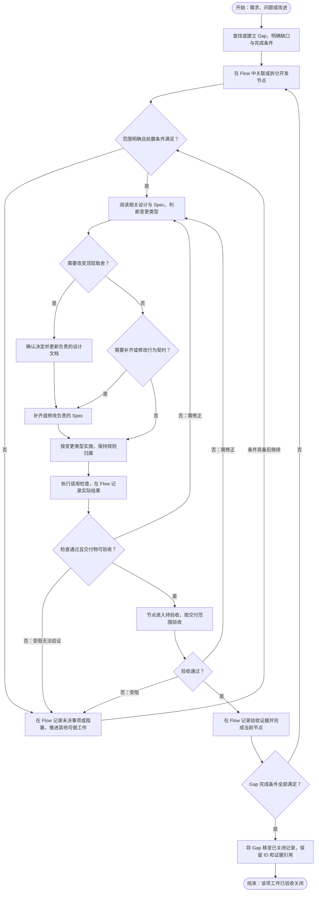

# 开发流程

本文件是修复 bug、新增功能和重构的统一入口。顶层设计及 Spec 的职责和决策权见[文档索引](../AGENTS.md#文档职责与决策权)；开发命令、测试、构建和编码约定也在本文件维护。

## 完整开发工作流

从一项需求、问题或改进开始，到对应 Gap 验收关闭结束。下图是完整开发流程的唯一总览；后续章节分别细化各环节，具体节点状态和依赖规则引用 [Flow](flow.md#节点状态转移邻接表)。这张图描述仓库开发工作，不描述 Agent 的运行时执行循环。



图中环节的具体做法分别见[变更分类](#从哪里开始)、[修复 bug](#修复-bug)、[功能变更](#新增或改变功能)、[重构](#重构)、[验证方法](#验收)与[完成标准](#完成标准)。文案或目录整理只修改负责的文档及引用，无需经过代码实现。

完成一个节点后，应按其交付范围验收；同一 Gap 有多个节点时，不能因其中一个节点完成就关闭 Gap。受阻、等待决定和无法验证均保留为未完成，条件具备后从原节点继续。目标变化或发现回归时重开原 Gap，并按 [Flow](flow.md#状态与证据更新)检查相关节点和下游依赖。

## 开发前后的进度同步

按[完整开发工作流](#完整开发工作流)同步记录：Gap 维护工作定义、目标引用、当前缺口和完成条件；Flow 维护节点关联、状态、依赖、阻塞和实际验证证据。已有对应工作时更新原记录，发现独立的新工作时再新增 Gap 和节点，不建立第二套清单。

开始、提交验收和结束时核对两份记录的引用是否有效；具体状态变更遵循 [Flow 状态规则](flow.md#节点状态转移邻接表)，不在本文件维护节点状态表。

## 从哪里开始

先说明“出现了什么”与“应该发生什么”，再判断需要改变哪一层。不要直接根据当前实现推断预期行为，也不要求每次变更都从愿景重新推导。

| 变更类型 | 第一步 | 通常修改什么 |
|---|---|---|
| 已有行为发生 bug | 复现问题，对照对应 Spec | 回归测试与实现；Spec 已正确时不修改它 |
| Spec 缺失或含糊 | 找到相关顶层设计和已确认需求，明确预期 | 先补齐或澄清负责该事实的 Spec，再实现 |
| 新增或改变功能 | 明确用户场景、功能范围和验收条件 | 需要时更新产品定义，再更新相关 Spec 与实现 |
| 改变核心概念、业务边界或质量取舍 | 提出要改变的顶层设计及原因 | 先确认顶层决策，再细化 Spec 与实现 |
| 保持行为的内部重构 | 明确必须保持的行为和依赖边界 | 实现与必要的文件职责映射；不改产品语义 |
| 文案或目录整理 | 明确需要保留的事实、路径及解析格式 | 对应文档和引用，检查链接及依赖该格式的校验 |

## 修复 bug

1. **记录可观察的问题。** 给出触发条件、最小复现、预期结果和实际结果。涉及执行中的问题时，还应说明取消、审批或并发输入发生在哪个阶段。
2. **定位预期的权威出处。** 从相关领域的 Spec 查找规则，需要时沿链接查阅顶层设计。只有实现偏离正确规范时，才按实现 bug 修复。
3. **建立有效的回归验证。** 在合适层次复现错误，确认验证能够发现原问题；优先检查用户可观察的结果、状态及关键顺序，不只断言内部函数被调用。
4. **修复拥有该规则的实现。** 不在界面、适配器或其他调用方叠加绕过逻辑，以掩盖负责模块的问题。
5. **验证修复及相关边界。** 覆盖原复现，并按影响检查失败、取消、恢复或持久化行为。测试要求见[测试约定](#测试)。

Spec 已正确表达预期时，无需为了“文档先行”改写它。若需要改变预期，按功能变更处理，不能把现有错误改写成规范。

无法复现时，先收集足以区分原因的证据，不将猜测描述为已定位或已修复。

## 新增或改变功能

1. **说明用户需要。** 谁在什么场景下需要什么能力，现有行为为什么不能满足，怎样判断完成。
2. **检查顶层设计。** 对照[产品定义](design/product.md)判断功能是否在范围内；若影响概念、业务边界或质量目标，先处理相应顶层设计。决策确认规则见[文档索引](../AGENTS.md#文档职责与决策权)。
3. **先定义行为契约。** 在负责该主题的 Spec 中写明输入、输出、生命周期、失败和退出方式，以及必要的兼容语义。引用上层概念，不重新定义。
4. **明确验收。** 将关键正常路径和边界情况转为可验证条件，再选择适当的自动或人工验证方式。
5. **实现并验证。** 按[软件架构](design/software-architecture.md)和[模块职责规范](spec/packages.md)选择落点，保持业务规则的归属。
6. **一起交付。** 产品范围、设计、Spec、实现和验证应保持一致。没有变化的文档不必为了凑齐层级而修改。

例如，支持“当前轮次中途引导”时，输入归属由[核心概念](design/concepts.md#输入归属)确定，接纳时点由[运行时规范](spec/runtime.md#轮次与步骤边界)细化，交互意图由[终端规范](spec/terminal.md#运行期间的输入)规定，再调整实现和验证。

## 重构

先列明行为、存储兼容性与依赖边界中哪些必须保持，再调整内部组织。只有文件或模块职责发生变化时，才同步修改[模块职责规范](spec/packages.md)。

若重构过程中发现需要改变用户行为、轮次语义或持久化约定，应拆清这些行为变化，并按对应流程处理，不能继续以“纯重构”交付。

## 规范与实现不一致时

| 情况 | 处理方式 |
|---|---|
| Spec 清楚，代码不符合 | 修复代码，保留正确规范 |
| Spec 未覆盖，但上层设计或已确认需求明确 | 补齐 Spec，再实现 |
| Spec 与顶层设计冲突 | 以顶层设计为约束修正 Spec，再调整实现 |
| 需求改变了现有顶层约定 | 先确认并更新相应顶层设计，再更新 Spec |
| 预期仍无法确定 | 明确列出未决行为，请求必要澄清；继续不依赖该决定的工作 |

文档先行期间，可以明确记录尚未实现的目标契约和差距；未完成的能力不得被标记为已实现或已通过验收。

## 一次开发如何记录

每次变更在当前任务或已有的问题、变更记录中说明：

- 问题或用户场景，以及影响范围。
- 预期行为所依据的设计与 Spec，是否存在待确认决定。
- 实现范围与必要的执行步骤。
- 验证结果、未完成项和已知限制。

产品目标与现状的差距统一记录在 [gap](gap.md)，开发节点的状态与依赖统一记录在 [flow](flow.md)。具体实施可以使用临时清单，不另建长期计划目录；业务规则仍归设计或 Spec，不能由节点记录重新定义。

## 完成标准

- 原问题或需求的验收条件已满足，相关行为与权威规范一致。
- 适当的回归、边界与兼容验证已完成；因环境限制无法执行的检查已明确列出，不能视为通过。
- 变更涉及的规范、代码、测试和引用路径已同步，未重复定义同一事实。
- 涉及取消、审批、持久化或工作环境操作时，已检查失败后的收尾与恢复行为。
- 按[开发命令](#开发命令)完成适用检查，并在变更说明中报告结果。

## 开发命令

```bash
uv sync                         # 安装 Python 项目与开发依赖
npm ci                          # 安装锁定的 Web TypeScript 开发依赖
npm run build:web               # 将 app.ts 编译为随包发布的 app.js
npm run check:web               # TypeScript 严格检查与构建产物语法检查
uv run super-agent              # 启动交互式命令行
uv run super-agent --web        # 启动本机 Web 界面
uv run pytest                   # 运行全部测试
uv run ruff format <files>       # 格式化修改过的 Python 文件
./scripts/coverage.sh            # 全项目覆盖率检查
./scripts/verify.sh              # 格式、静态检查、类型、测试、并发和覆盖率
uv run python scripts/smoke.py   # 伪终端与 Web/ACP 端到端验收
./scripts/build-local.sh        # 构建并安装本地程序
```

Web 交互源码使用 TypeScript，样式与页面结构保持原生 CSS 和 HTML，不引入浏览器运行时框架。修改 `super_agent/web/static/app.ts` 后必须执行 `npm run build:web` 并一起提交生成的 `app.js`；Python 包和本地 HTTP 服务不依赖 Node.js，Node.js 只用于开发期类型检查和构建。

## 测试

- 所有测试代码放在 `tests/` 下，不得在生产包目录内新增测试模块。
- 测试按行为命名，例如 `test_tool_call_feeds_result_back_to_model`。
- 运行时变更应覆盖转移和可观察的 engine 行为。
- 转移测试断言运行数据变更、动作队列变更和调度动作的完整顺序。
- 重置测试证明 `system` 消息得到保留。
- 解析文档或源码的测试必须在格式改变时明确失败，不能悄悄匹配不到任何内容。
- 共享的测试替身放在 `tests/fakes/`；测试作为子进程启动的辅助程序放在 `tests/helpers/`，通过 `python -m tests.helpers.<name>` 运行。
- `tests/web/test_static_ui.py` 校验页面地标、控件名称、状态区域、TypeScript 服务端路径与安全 DOM 约束；修改 Web 静态文件后需先执行 `npm run build:web`，其中 `node --check` 一项在未安装 Node.js 时跳过并在输出中注明。

使用 `./scripts/verify.sh` 执行全部检查，包括格式、静态检查、严格类型检查、测试、在 `python -X dev` 下运行的并发测试子集，以及覆盖率。GitHub Actions 在每次推送和变更审阅记录时运行该脚本。

## 构建

`./scripts/build-local.sh` 构建项目，并将 `super-agent` 安装到 `/usr/local/bin`。设置 `SUPER_AGENT_INSTALL_DIR` 可覆盖安装目录，`SUPER_AGENT_VENV` 可覆盖命令行程序使用的虚拟环境，`SUPER_AGENT_BINARY_NAME` 可覆盖安装后的名称。

## 验收

`./scripts/verify.sh` 覆盖机器能够快速完成的检查。另有需要真实终端或真实进程边界的验收检查：

`uv run python scripts/smoke.py` 启动真实的 `super-agent` 进程，连接实现 OpenAI chat-completions 流式协议的本地 HTTP 服务器。不访问外部网络，只替换模型服务商。`--front-end` 选择要驱动的前端，默认驱动本平台支持的全部前端：

- `terminal` 在伪终端中驱动命令行，只在 POSIX 有效。它按顺序检查：

1. `-h` 将用法写入标准错误并以 `0` 退出，且用法不会声称默认值为 false 的参数默认为 true。
2. 未知参数以 `2` 退出，并显示 `flag provided but not defined: -x`。
3. 无效审批模式，以及同时传入 `--yolo` 和 `--approval-mode`，均以 `1` 退出。
4. 缺少服务商凭据时以 `1` 退出，并指出应设置的变量。
5. 提交问题后，对话记录中出现流式回复。
6. 会话中调整窗口大小后，后续输出保持在新宽度内。
7. 轮次进行中按 Ctrl+C 会取消该轮，循环仍可继续使用；空闲时按 Ctrl+C 则退出。
8. `/clear`、`/compact` 和 `/undo` 均执行完成，之后会话仍可使用。
9. 输入 `/` 展示实时命令列表，中文问题完整到达模型。

- `web` 启动 `--web` 后检查首页是可读页面、快照报告空闲、一轮回复按事件流式到达且以空错误结束、运行中再次提交返回 `409`、取消后界面继续应答。
- `acp` 以 JSON-RPC 驱动 `--acp`，检查 `initialize` 的能力声明、`session/new` 的会话标识与可用模式、`session/prompt` 的增量文本与 `end_turn`，以及关闭标准输入后以 `0` 退出。

冒烟测试有意不精确断言两类属性，它们分别由其他测试负责：**对话记录修改**（`/compact` 保留最新轮次，并扩展保留范围以包含开头工具结果的关联消息；`/undo` 先恢复文件再截断历史；重置保留 `system` 消息）由能精确检查结果的 session 测试固定；**交互与渲染**由注入输入、捕获普通输出的 `TerminalApplication` 测试固定。冒烟测试只证明这些路径能够通过真实界面到达，且不会造成破坏。

仍需人工检查的内容包括：颜色可读性，Linux 终端、tmux 与 SSH 下的行为，Unicode 与宽字符，终端原生选择和复制，以及剪贴板后备路径。可见的交互式命令行变更必须在变更审阅记录中记录测试过的终端。

## 并发

并发实现使用 asyncio：每次运行携带独立的 `RunContext` 和一个 `asyncio.Task`，通道使用 `asyncio.Queue`，子进程使用 `create_subprocess_exec`。适配器在边界将 `asyncio.CancelledError` 转换为项目的 `Cancelled`；它属于 `BaseException`，不会被 `except Exception` 捕获。

Python 单线程事件循环排除了对共享内存的未同步访问，但引入了另一类问题：某些状态只有在读取与写入之间不让出执行权时才安全。当前采用以下近似检查：

- `./scripts/verify.sh` 使用 `python -X dev` 运行并发测试目录。它启用 asyncio 调试模式，让未等待的协程、未关闭的传输和缓慢回调成为可见问题。
- `pytest-asyncio` 使用 `strict` 模式，每个测试获得独立事件循环，避免意外跨测试共享协程。
- `tests/runtime/test_concurrency_stress.py` 提供主动让出执行权的压力测试。每次端口调用在返回前让出执行权多次，同时其他协程读取快照、取消进行中的轮次，让循环尽可能发生交错。每个场景重复足够次数以覆盖多种交错，精确断言对话记录、最终状态，以及状态观察者从不在持锁时运行。这只是近似检查：它扩大暴露问题的机会，不能证明问题不存在。

依赖特定交错顺序的同步问题仍可能逃过这些检查，这就是剩余缺口。修改 engine 循环、运行控制器、动作队列或 session 消息发送器时，必须在变更审阅记录中说明如何确认提交点仍保持原子性。

## 实现与重构

- 优先使用具体领域名称，避免泛化的基础设施名称。
- 接口放在适配器边界，不要在每个内部函数之间都引入接口。
- 每个文件专注一项职责。
- 仅在组合边界转换传输 DTO 和展示 DTO。
- 使用转移测试和应用用例测试保持行为不变。
- 实现落点和依赖约束见[模块职责](spec/packages.md)，不在开发方法中另设分工。

使用现有术语：`State`、`RuntimeData`、`Event`、`RuntimeDataChange`、`ActionPlan`、`ScheduledAction`、`transition`。

## Python 约定

整个代码库遵循以下风格：

- **命名遵循 PEP 8。** 模块、函数和方法使用 `snake_case`；类使用 `PascalCase`；模块常量和枚举成员使用 `UPPER_SNAKE`；数据类字段使用 `snake_case`。例如 `STATE_IDLE`、`AppendUserMessage`、`run_turn` 和 `apply_runtime_data_changes`。
- **模块名使用 snake_case**，例如 `runtime/machine/transition.py`。
- **包通过 `__init__.py` 重新导出公开接口**，因此 `machine.STATE_IDLE` 和 `machine.transition` 从包命名空间解析。
- **值类型使用带显式编解码器的 `@dataclass`**（`super_agent/jsonutil.py`），不使用校验库。每个字段用 `json_field` 声明 JSON 键，保证键名不随 Python 属性名变化。
- **序列字段**在冻结类型中使用元组，在可变类型中使用列表。冻结的值类型不得与调用方共享可变容器。
- **端口使用 `typing.Protocol`**，只在适配器边界声明。只有实际进行 `isinstance` 检查时才添加 `@runtime_checkable`。
- **封闭类型集合**（事件、运行数据变更、调度动作）使用基类，其 `__init_subclass__` 拒绝在自身模块外声明子类，并用 `kind` 类变量作为注册表键。
- **错误处理**：使用 `raise X(...) from err` 包装错误，使用 `super_agent.errors.errors_is` 判断错误身份，使用 `JoinedError` 聚合错误。取消异常转换按[并发约定](#并发)处理。

## Git 与变更记录

- 使用简洁的约定式提交消息，例如 `fix: preserve reasoning replay`。
- 分支按范围命名，例如 `feat/session-notifications`、`fix/tool-approval`。
- 变更审阅记录应说明目的、主要修改文件、测试输出和本地配置注意事项。
- 仅对可见的交互式命令行变更添加截图。

## 仓库说明

`CLAUDE.md` 是指向 `AGENTS.md` 的符号链接，两者指向同一文件；编辑任一名称即可，无需同步两份内容。

## 保持文档同步

- 按[内容归属与去重规则](../AGENTS.md#内容归属与去重规则)更新唯一出处；必读顺序、执行要求、文档职责、决策权或规则入口变化时更新 `AGENTS.md`。
- 行为变化时，按上述工作流先更新 `docs/` 中负责该主题的文档，再修改代码。
- 事实迁移到新位置时，删除旧副本，避免两份内容发生偏差。

## 目录入口

代码落点见[模块职责](spec/packages.md)，文档落点见[文档职责](../AGENTS.md#文档职责与决策权)。

## 文档校验

按[文档职责](../AGENTS.md#文档职责与决策权)逐项检查新增或迁移内容的唯一出处，检查本地链接（包括锚点）、Gap/Flow 引用以及依赖图无环性。解析格式发生改变时，相关检查必须明确失败，不能以匹配为空视为通过。

`tests/architecture/test_spec.py` 核对状态机转移表、图与实现；`tests/architecture/test_dependencies.py` 检查包导入约束；`tests/architecture/test_theme.py` 检查界面配色约束。它们只覆盖相应契约，不能替代全产品验收。

### 新增状态机转移

1. 在 `runtime/machine/event.py` 中声明事件及其 `event_kind`，并加入 `ALL_EVENTS`。
2. 在 `runtime/machine/transition.py` 中编写处理函数并在 `_new_transition_registry` 中注册。
3. 返回所需的 `runtime_data_changes` 和 `ActionPlan`，同步更新[状态机转移表](spec/machine.md#转移表)。
4. 在 `tests/runtime/test_transition.py` 中覆盖合法路径、拒绝路径和精确输出顺序。
