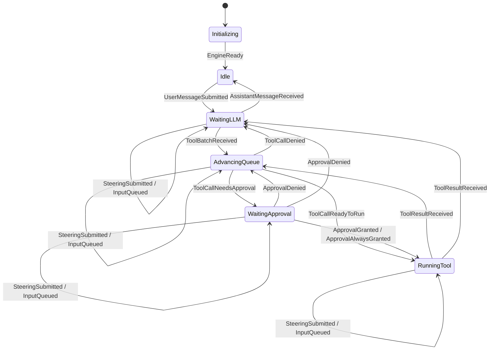

# 状态机

`runtime/machine` 是纯领域核心，负责状态、事件、运行数据、运行数据变更、动作计划、调度动作和转移。它不执行 I/O、不加锁，也不调用模型或工具。

本文件是**转移图的唯一权威来源**。下方的表格和图都会由 `tests/architecture/test_spec.py` 与实际运行的状态机进行核对；修改其中一方而未同步修改 `runtime/machine`，会导致测试失败。

Turn 与 Step 的概念边界见[核心概念](../design/concepts.md)，目标执行契约见[运行时规范](runtime.md#轮次与步骤边界)。下方转移表覆盖当前已实现的事件集合；输入归属的行为见[输入接纳](#输入接纳)。

## 执行流程决策

影响 Agent 执行顺序和状态合法性的规则由 Machine 统一决定，包括批次中下一调用的选择、权限检查时点、审批后的动作、结果结算、失败或拒绝后是否继续，以及何时重新调用模型。权限策略负责判断操作是否获准，模型选择由配置负责；Machine 根据这些外部判断的结果转移。

`ToolBatchReceived.tools_enabled` 表示外层提供的工具能力事实，默认为 `True`；为 `False` 时，Machine 在写入助手工具调用消息前以 `ProtocolViolationError` 拒绝批次，原因是 `model returned tool call while tools are disabled`。

`ToolResultReceived` 携带成功文本或 `error` 异常事实。普通工具异常由 Machine 结算为 `Error: <error>`，与成功结果一样继续剩余调用；剩余调用耗尽时才调度模型。取消不作为普通工具失败，仍走 `CancelRequested`。

## 状态

`State` 是在 `runtime/machine/state.py` 中声明的字符串类型，共有六种状态：

| 状态 | 含义 | 进入来源 | 离开事件 |
|---|---|---|---|
| `Initializing` | engine 已构造，尚未启动 | engine 构造 | `EngineReady` |
| `Idle` | 没有正在进行的模型请求、工具调用或审批 | 初始化、普通回复、取消、重置、错误 | `UserMessageSubmitted` |
| `WaitingLLM` | 模型调用进行中，包括流式输出 | `UserMessageSubmitted`、工具批次完成 | 回复、工具批次、取消、错误 |
| `AdvancingQueue` | 分发工具批次中的下一个调用 | 收到工具批次、工具结果、审批被拒绝 | 需要审批、调用可执行、策略拒绝、取消、错误 |
| `WaitingApproval` | 等待用户决定是否允许高风险调用 | 下一个调用需要审批 | 允许、始终允许、拒绝、取消、错误 |
| `RunningTool` | 正在执行一个工具调用 | 调用不需要审批或已获批准 | 工具结果、取消、错误 |

`AdvancingQueue` 是调度状态，本身不执行工具。

## 转移图



图中有意**只绘制状态专属的边**。下方的全局事件可从任何状态接收，只在表格中定义；绘制它们的全部 18 条边只会增加噪声，不会增加信息。

## 转移表

这是权威边列表。`tests/architecture/test_spec.py` 枚举全部 6 个状态 × `machine.ALL_EVENTS`（16 个事件，共 96 个组合），并断言接受的组合及其 `next_state` 与本表完全一致。检查是双向的，因此未记录在文档中的边也会导致失败。

| 状态 | 事件 | 下一状态 | 运行数据变更 | 动作计划 |
|---|---|---|---|---|
| Initializing | EngineReady | Idle | - | - |
| Idle | UserMessageSubmitted | WaitingLLM | AppendUserMessage, OpenTurn, OpenStep, TakeQueued | 调度 CallModel |
| WaitingLLM | SteeringSubmitted | WaitingLLM | QueueSteering | - |
| AdvancingQueue | SteeringSubmitted | AdvancingQueue | QueueSteering | - |
| WaitingApproval | SteeringSubmitted | WaitingApproval | QueueSteering | - |
| RunningTool | SteeringSubmitted | RunningTool | QueueSteering | - |
| WaitingLLM | InputQueued | WaitingLLM | QueueInput | - |
| AdvancingQueue | InputQueued | AdvancingQueue | QueueInput | - |
| WaitingApproval | InputQueued | WaitingApproval | QueueInput | - |
| RunningTool | InputQueued | RunningTool | QueueInput | - |
| WaitingLLM | AssistantMessageReceived | Idle | AppendAssistantMessage, CloseStep | - |
| WaitingLLM | ToolBatchReceived | AdvancingQueue | AppendAssistantMessage, SetToolCallBatch | 调度 CheckToolPermission |
| WaitingApproval | ApprovalGranted | RunningTool | SetCurrentTool, ClearPendingTool | 调度 RunTool |
| WaitingApproval | ApprovalAlwaysGranted | RunningTool | SetCurrentTool, ClearPendingTool | 调度 RunTool |
| WaitingApproval | ApprovalDenied | AdvancingQueue | ClearPendingTool, AppendToolResult | 调度 CheckToolPermission |
| RunningTool | ToolResultReceived | AdvancingQueue | AppendToolResult, ClearCurrentTool | 调度 CheckToolPermission |
| AdvancingQueue | ToolCallNeedsApproval | WaitingApproval | SetPendingTool, AdvanceToolCallBatch | 调度 AwaitApproval |
| AdvancingQueue | ToolCallReadyToRun | RunningTool | AdvanceToolCallBatch, SetCurrentTool | 调度 RunTool |
| AdvancingQueue | ToolCallDenied | AdvancingQueue | AdvanceToolCallBatch, AppendToolResult | 调度 CheckToolPermission |
| WaitingApproval | ApprovalDenied | WaitingLLM | ClearPendingTool, AppendToolResult, ClearToolCallBatch, AdvanceStep, AcceptSteering | 调度 CallModel |
| RunningTool | ToolResultReceived | WaitingLLM | AppendToolResult, ClearCurrentTool, ClearToolCallBatch, AdvanceStep, AcceptSteering | 调度 CallModel |
| AdvancingQueue | ToolCallDenied | WaitingLLM | AdvanceToolCallBatch, AppendToolResult, ClearToolCallBatch, AdvanceStep, AcceptSteering | 调度 CallModel |
| any | ErrorOccurred | Idle | FlushStreamingAssistant, AppendToolResult, ClearPendingTool, ClearCurrentTool, ClearToolCallBatch, ClearSteering, CloseStep | 清空已有动作 |
| any | CancelRequested | Idle | FlushStreamingAssistant, AppendToolResult, ClearPendingTool, ClearCurrentTool, ClearToolCallBatch, ClearSteering, ClearQueued, CloseStep | 清空已有动作 |
| any | ResetRequested | Idle | ResetConversation | 清空已有动作 |

`any` 表示所有状态，包括 `Initializing` 和 `Idle`。`any` 行的运行数据变更列只是可能变更的概览，不是精确列表：`handle_error_occurred` 和 `handle_cancel_requested` 为每个尚未结算的调用追加一个 `AppendToolResult`，因此数量随起始状态变化（错误从 `WaitingLLM` 开始是 6 项，取消是 7 项；从 `WaitingApproval`、`RunningTool` 或仅含一次调用的 `AdvancingQueue` 批次开始时分别为 7 项和 8 项）。所以一致性测试只固定边集合和 `next_state`，各起始状态的精确变更列表由 `tests/runtime/test_transition.py` 固定。

`ApprovalDenied`、`ToolResultReceived` 和 `ToolCallDenied` 在仍有调用时进入 `AdvancingQueue`，调度携带下一调用的 `CheckToolPermission(call)`；批次耗尽时直接清理批次、推进 Step、接纳引导并调度 `CallModel`，进入 `WaitingLLM`。两种分支均在表和图中列出。

`AssistantMessageReceived` 的目标状态也依赖运行数据：没有待接纳输入时结束 Turn 并回到 `Idle`，表和图列出此分支；存在待接纳输入时，当前 Step 结束、下一个 Step 开始并继续调度 `CallModel`。带引导的分支由 `tests/runtime/test_transition.py` 与 `tests/runtime/test_steering.py` 固定。

两条拒绝路径具有不同含义：

- `ApprovalDenied`：**用户**在 `WaitingApproval` 状态下拒绝，结果文本为 `denied: <tool-name>`。
- `ToolCallDenied`：**权限策略**在 `AdvancingQueue` 状态下直接拒绝，结果文本为 `denied by permission policy: <reason>`。

两者都会将拒绝信息作为该调用的工具结果追加，并继续推进队列，让模型选择其他动作，而不丢失整轮对话。

`handle_error_occurred` 和 `handle_cancel_requested` 都为模型请求的每个调用提供结果：前者写入错误原因，后者写入 `cancelled`。已分发的调用必定且只会位于三处之一：等待审批、正在执行，或批次尚未推进到该调用。因此，尚未结算的集合包括待审批调用、当前调用和批次中剩余的每个调用，每个都必须得到工具结果。未得到结果的工具调用会使服务商以 400 拒绝对话记录；由于记录会持久化，恢复会话后错误仍然存在。因此取消和失败一样必须遵守此规则，任何取消路径都不能让已分发调用没有结果。

## RuntimeData

`RuntimeData` 是完整的可变状态机数据（`runtime_data.py`）。它只能被替换，不能原地修改。

```python
@dataclass(slots=True)
class RuntimeData:
    state: State
    messages: list[Message] = field(default_factory=list[Message])
    pending_tool: ToolCall | None = None  # 等待审批
    pending_permission: PermissionRequest | None = None
    current_tool: ToolCall | None = None  # 正在执行
    tool_batch: ToolCallBatch | None = None  # 剩余队列
    step: Step | None = None  # 当前 Turn 内的步骤
    steering: tuple[SteeringInput, ...] = ()  # 已受理、尚未纳入请求的中途引导
    queued: tuple[QueuedInput, ...] = ()  # 已受理、尚未开始的下一 Turn 输入
    turn: int = 0  # 本次对话内的当前轮次，从 1 开始
    streaming_content: str = ""
    streaming_reasoning: str = ""
```

`Step`（`step.py`）是当前 Turn 内的步骤标识，携带从 `1` 开始递增的序号。它随转移打开、推进和关闭，边界时点见[运行时规范](runtime.md#轮次与步骤边界)；`ResetConversation` 与关闭步骤的转移都会清除它。

`SteeringInput`（`steering.py`）是一次已受理但尚未纳入模型请求的中途引导，携带正文、附件，以及调用方给出的输入标识。标识是不透明值：Machine 只保存和搬运，用它让接纳与作废能被回报给提交方，不参与任何守卫。没有标识的输入照常接纳，只是无法被单独回报。它只存在于运行数据，不进入会话记录。

`QueuedInput`（`queued.py`）是一次已受理、等待下一 Turn 开始的输入，携带正文、附件与输入标识，标识的含义与中途引导相同。它与 `SteeringInput` 的差别只在归属：中途引导随当前 Turn 的 Step 边界被接纳，排队的输入跨过 Turn 边界存活，直到某个 Turn 以它的标识开始。`turn` 是本次对话内的轮次序号（从 `1` 开始，`ResetConversation` 复位），它是「这个输入成了第几轮」的回报依据；序号不进入会话记录，恢复会话后新的 Turn 仍从 `1` 开始。

## 输入接纳

`SteeringSubmitted` 只由四个运行中的状态接受：`WaitingLLM`、`AdvancingQueue`、`WaitingApproval` 和 `RunningTool`。`Idle` 与 `Initializing` 不接受它——中途引导属于已经在进行的 Turn，开始新的 Turn 仍然是 `UserMessageSubmitted` 的职责，否则一条迟到的输入会静默变成一轮新对话。

接纳分两步，这是本节的核心：

1. **受理**：事件到达时只执行 `QueueSteering`，把输入放进 `steering` 队列。状态不变，也不调度动作，因此正在流式返回的请求不会被改写，正在执行的工具不会被打断，等待中的审批不会被打断。
2. **接纳**：下一个 Step 开始时执行 `AcceptSteering`，按提交顺序把队列中的每一项作为 `user` 消息追加到会话，并清空队列。接纳点包括工具批次最后一次调用结算（工具结果、用户拒绝或策略拒绝）和 `AssistantMessageReceived`（存在待接纳输入时继续 Turn 而不是结束）。

`AcceptSteering` 与 `CloseStep` 一样容忍空队列：到达 Step 边界就请求接纳，没有等待中的输入时什么也不做。

Turn 结束时等待中的输入随 Turn 一起作废：`CancelRequested`、`ErrorOccurred` 执行 `ClearSteering`，`ResetRequested` 由 `ResetConversation` 一并清空。因此 `Idle` 与 `Initializing` 不得持有待接纳输入，否则整轮对话可能被上一轮残留的指令改写；这条规则是不变量的一部分。

### 排队输入

`InputQueued` 与 `SteeringSubmitted` 接受相同的四个运行状态，理由对偶：排队的输入属于**下一个** Turn，所以必须有一个 Turn 让它跟随。`Idle` 与 `Initializing` 不接受它——没有正在进行的 Turn 时，提交方应当直接开始一轮，而不是把输入挂在一轮谁也不打算开始的对话上。

受理只执行 `QueueInput`，状态与当前 Turn 的 Step、工具、审批都不变。接纳点是 Turn 的开始：`UserMessageSubmitted` 携带 `input_id`，同一个提交里执行 `OpenTurn` 与 `TakeQueued`，把该标识对应的排队输入从队列移除。因此「某输入成了第几轮」是提交时就能确定的事实，`QueuedInputAccepted` 用 `turn` 回报它，不需要前端推断。

`TakeQueued` 容忍标识指不到任何输入（含空标识）：输入可能刚被取消丢掉，而以它正文开始的这一轮仍然成立。

排队输入不参与 Turn 收尾的「是否继续」判断（见[运行时规范](runtime.md#轮次与步骤边界)）：它只影响下一个 Turn 是否开始。取消会丢弃排队输入（`ClearQueued`），失败不会——错误之后用户排队的输入仍然是用户要的内容，由应用决定是否继续执行。`ResetRequested` 由 `ResetConversation` 一并清空。

未被接纳的输入不参与任何请求，也不写入会话记录，恢复会话后不会重现；持久化边界见[会话规范](session.md#运行与轮次的记录)。接纳时点与 Turn 边界的关系见[运行时规范](runtime.md#轮次与步骤边界)。

## 不变量

`validate_runtime_data`（`snapshot.py`）是权威校验入口，规则如下。`snapshot_from` 在每次转移前执行校验，`RuntimeDataChangeApplier` 再对克隆的候选数据执行校验，因此非法中间状态永远不会被提交。

全局规则：

- 工具批次索引位于 `[0, len(calls)]` 内。
- 存在待审批权限时，必须存在待审批工具。
- 流式内容只允许存在于 `WaitingLLM`。
- `Idle` 和 `Initializing` 没有当前 Step；其余状态必须有当前 Step，且序号不小于 `1`。
- `Idle` 和 `Initializing` 不得持有待接纳的中途引导；其余状态可以持有任意多项。
- 排队输入不受状态限制：它跨过 Turn 边界存活，所以 `Idle` 持有它是正常状态，而不是残留。

各状态的规则：

| 状态 | 必须存在 | 不得存在 |
|---|---|---|
| `Initializing`、`Idle`、`WaitingLLM` | — | 待审批工具、待审批权限、当前工具、工具批次 |
| `AdvancingQueue` | 工具批次，且索引合法 | 待审批工具、待审批权限、当前工具 |
| `WaitingApproval` | 批次、待审批工具、待审批权限；待审批工具等于 `calls[index-1]` | 当前工具 |
| `RunningTool` | 批次、当前工具；当前工具等于 `calls[index-1]` | 待审批工具、待审批权限 |

要求匹配 `calls[index-1]`，是因为批次在分发调用**之前**推进：正在审批或执行的调用始终是刚刚从批次取出的调用。

## 错误

三种错误类型区分不同问题（`errors.py`）：

- `UnexpectedEventError`：当前状态不接受该事件。
- `ProtocolViolationError`：事件类型合法，但内容与当前数据不匹配，例如调用 ID 不匹配、队列尚未排空就宣布批次完成，或工具批次为空。
- `InvariantViolationError`：`RuntimeData` 本身处于不可能成立的状态。

## RuntimeDataChange

`RuntimeDataChange` 同步地从当前 `RuntimeData` 构造下一份数据。完整类型集合为 `machine.ALL_RUNTIME_DATA_CHANGES`（`runtime_data_change.py`）；应用器（`runtime_data_change_applier.py`）负责克隆、按顺序应用和校验。

结束运行的转移不能直接丢弃任务，必须显式刷新并清理：`FlushStreamingAssistant`、`CloseStep`、`ClearSteering`、`ClearPendingTool`、`ClearCurrentTool`、`ClearToolCallBatch`。需要撤回排队任务的转移则设置 `ActionPlan.clear_existing`。

步骤数据的打开与推进各有前置条件：`OpenStep` 要求当前没有步骤，`AdvanceStep` 要求存在当前步骤，`CloseStep` 可在没有步骤时重复执行。中途引导的两个变更方向相反：`QueueSteering` 只追加、不在状态上设守卫，`AcceptSteering` 与 `ClearSteering` 都可在队列为空时重复执行。

`ResetConversation` 清除所有非 `system` 消息，保留全部 `system` 消息。持久化与回放见[会话重置](session.md#重置)。

## ActionPlan 与 ScheduledAction

```python
@dataclass(frozen=True, slots=True)
class ActionPlan:
    clear_existing: bool = False
    schedule: tuple[ScheduledAction, ...] = ()
```

清除过期队列任务与调度新任务构成同一个决策。提交与执行的原子性机制见[运行时循环](runtime.md#运行时循环)。

共有四种 `ScheduledAction`（`scheduled_action.py`，由 `machine.ALL_SCHEDULED_ACTIONS` 枚举）：

| 动作 | 工作内容 |
|---|---|
| `CallModel` | 请求模型，并通过流式分片返回输出 |
| `RunTool` | 执行一个工具调用 |
| `CheckToolPermission(call)` | 对 Machine 已选择的具体调用执行权限检查 |
| `AwaitApproval` | 等待 Session 提供的审批决定 |

模型调用、工具执行和人工审批都经过同一条“动作 → 结果 → 事件”路径，因此审批不需要第二个循环，也不需要让 `runtime/session` 拥有调度权。

## 注册表

转移位于 `transition.py` 中唯一的包私有静态注册表，以状态和事件种类为键：

```python
@dataclass(frozen=True, slots=True)
class TransitionKey:
    state: State
    event_kind: str
```

`register_transition` 在键重复时抛出错误，防止新规则悄悄覆盖旧规则。零值 `State` 不是合法运行状态，因此三条全局规则只需各注册一次，不必为六个状态重复注册：

```python
global_rules = ((TransitionKey(ZeroState, ErrorOccurred.kind), adapt_transition(handle_error_occurred)),)
```

查找时先尝试精确键，再尝试零状态键；都不存在则报告 `UnexpectedEventError`。

处理函数接受具体事件类型，不能直接存入注册表。`adapt_transition[E: Event]` 统一函数签名：从处理函数第二个参数的注解读取具体事件类型，并在调用时用 `isinstance` 检查，因此注册错误会返回 `ProtocolViolationError`，而不是在稍后以无关方式失败。

不需要快照的处理函数接收 `_ MachineSnapshot`。需要关联事件与当前数据的处理函数会读取快照，例如 `handle_tool_result_received` 检查当前工具存在，且事件中的调用 ID 与之匹配。

## 示例：一条用户消息

假设 `Idle` 状态收到 `UserMessageSubmitted`。

1. **注册**：`TransitionKey(STATE_IDLE, UserMessageSubmitted.kind)` 映射到 `adapt_transition(handle_user_message_submitted)`。
2. **决策**：处理函数返回 `next_state=STATE_WAITING_LLM`、`runtime_data_changes=(AppendUserMessage(...),)` 和 `ActionPlan(schedule=(CallModel(),))`。由于不需要撤回任何动作，`clear_existing` 保持 `False`。
3. **应用**：`snapshot_from` 校验当前数据，`transition` 产生决策，应用器克隆并修改数据，`validate_runtime_data` 检查候选数据，engine 将数据与计划一起提交。
4. **分发**：此时 `CallModel` 才开始运行，经过 `ScheduledActionRunner` → `ScheduledActionExecutor` → `Model.next`。engine 已处于 `WaitingLLM`，交互式命令行可以展示模型正在工作。
5. **继续**：`ActionResultResolver` 将模型结果转换为下一事件：普通回复成为 `AssistantMessageReceived`（→ `Idle`），工具请求成为 `ToolBatchReceived`（→ `AdvancingQueue` → `CheckToolPermission`）。

因此，一条用户消息不只是触发一次状态变更，而是启动一个由事件驱动的循环。完整循环见 `runtime.md`。

## 术语

- `State`：当前运行阶段。
- `Event`：触发转移的事实。
- `RuntimeData`：完整的可变状态机数据。
- `RuntimeDataChange`：对克隆的 `RuntimeData` 进行的同步变换。
- `ActionPlan`：与运行数据共同提交的队列计划，可清除过期任务并调度新任务。
- `ScheduledAction`：请求执行的任务，包括模型调用、工具执行、队列处理或审批等待。
- `MachineSnapshot`：经过校验、只公开转移守卫的只读视图。
- `transition`：包含状态、调用与队列守卫的纯状态机决策。
- `RuntimeDataChangeApplier`：在克隆数据上应用运行数据变更，并校验结果。
- `Step`：当前 Turn 内的步骤标识，携带从 `1` 开始递增的序号。
- `SteeringInput`：已受理、尚未纳入模型请求的中途引导。
- `ToolCallBatch`：当前批次中排队的调用，通过索引标记推进位置。

engine 侧术语 `Engine`、`ActionQueue`、`ActionResultResolver`、`ScheduledActionRunner`、`RunController`、`ApprovalStore` 和 `Policy` 在 `runtime.md` 中定义。

## 开发入口

修改转移的操作步骤见[开发流程](../development.md#新增状态机转移)。
